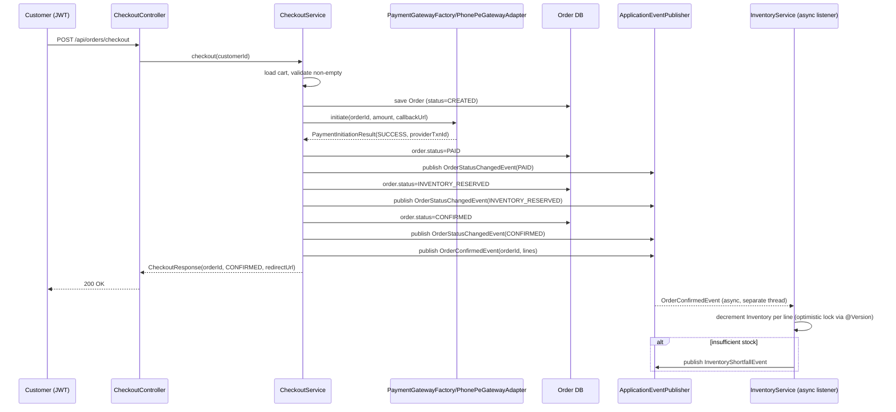
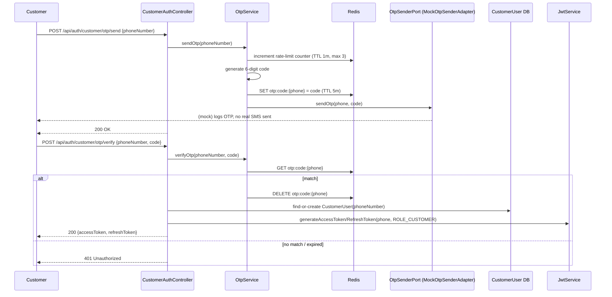

# Architecture

## 1. Module breakdown

Maven multi-module modular monolith (see ADR 0001). All modules share one JVM/deployment unit
(`ecommerce-app`), communicating in-process.

| Module | Responsibility |
|---|---|
| `ecommerce-common` | `BaseEntity` (id/createdAt/updatedAt/`@Version`), `ApiResponse`/`PageResponse` envelopes, shared exceptions, global exception handler |
| `ecommerce-notification` | `OtpSenderPort` + `MockOtpSenderAdapter` (logs only, never real SMS) |
| `ecommerce-identity` | Admin auth (username/password -> JWT), Customer auth (phone + OTP -> JWT), `JwtService`, Redis-backed `OtpService` |
| `ecommerce-catalog` | `Product`/`Category` entities, Specification-based filtering, public browse endpoints, admin CRUD |
| `ecommerce-inventory` | `Inventory` entity (optimistic locking), async `OrderConfirmedEvent` consumer that decrements stock |
| `ecommerce-cart` | Redis-backed `Cart`/`CartItem`, add/remove/view endpoints |
| `ecommerce-payment` | `PaymentGateway` strategy interface, `PhonePeGatewayAdapter`, `PaymentGatewayFactory` |
| `ecommerce-order` | `Order`/`OrderItem`/`OrderStatus` state machine, `CheckoutService` orchestration, PhonePe webhook endpoint with idempotency |
| `ecommerce-app` | `@SpringBootApplication`, Spring Security filter chain, application.yml profiles, SSE admin stream |

## 2. Pattern catalog (why each pattern was chosen)

- **Strategy + Adapter** (`PaymentGateway` / `PhonePeGatewayAdapter`): payment providers change
  independently of checkout logic; the interface is the seam that lets `CheckoutService` stay
  provider-agnostic.
- **Factory** (`PaymentGatewayFactory`): resolves a `PaymentGateway` by name without callers
  `new`-ing or importing a concrete adapter, enabling config-driven provider selection.
- **Observer / event-driven** (`ApplicationEventPublisher` + `@EventListener` + `@Async`):
  decouples checkout-request latency from inventory-write latency (ADR 0004) and powers the SSE
  admin stream (ADR 0005) without tight coupling between `CheckoutService` and inventory/SSE code.
- **Repository** (Spring Data JPA): standard data-access abstraction, keeps persistence details
  out of services.
- **Specification** (`ProductSpecifications`): composable, type-safe product filtering that
  avoids an explosion of ad-hoc repository finder methods per filter combination.
- **State machine** (`OrderStatus` enum + `Order.transitionTo`): makes illegal order-status jumps
  (e.g. `CREATED` -> `CONFIRMED` skipping payment) a thrown `BusinessException` instead of a
  silent bug.
- **Circuit breaker** (Resilience4j `@CircuitBreaker` on `PhonePeGatewayAdapter` and
  `MockOtpSenderAdapter`): outbound calls to external-ish systems (payment provider, SMS sender)
  fail fast under sustained failure instead of exhausting threads/connections.

## 3. Security model

- Stateless JWT (access + refresh) for both admin (`ROLE_ADMIN`) and customer (`ROLE_CUSTOMER`)
  principals; no server-side session (`SessionCreationPolicy.STATELESS`).
- Admin passwords are BCrypt-hashed (`PasswordEncoder` bean).
- Customer auth is phone + OTP (see ADR 0002); guests are unauthenticated, no entity needed.
- `@PreAuthorize("hasRole('ADMIN')")` on admin mutation endpoints (catalog admin CRUD), enforced
  at both the URL-pattern level (`SecurityFilterChain`) and the method level (defense in depth).
- `@Valid` Bean Validation on all request DTOs.
- Explicit CORS allow-list (`http://localhost:3000` by default) with `allowCredentials(true)` -
  never a wildcard origin combined with credentials.
- CSRF is disabled with an inline code comment justification: this is a stateless bearer-token
  API with no cookie-based session, so there is no session to forge via CSRF.
- Secrets (JWT signing key, PhonePe merchant id/salt key) are read via `${ENV_VAR}` placeholders
  in `application.yml`, never hardcoded; see `.env.example`.

## 4. Event flow

### 4.1 Checkout -> payment -> order confirmed -> async inventory decrement



### 4.2 OTP login flow



## 5. Payment gateway abstraction contract

```java
public interface PaymentGateway {
    String gatewayName();
    PaymentInitiationResult initiate(String merchantOrderId, BigDecimal amount, String callbackUrl);
    PaymentVerificationResult verify(String providerTransactionId);
    RefundResult refund(String providerTransactionId, BigDecimal amount);
}
```

`CheckoutService` and any other order-orchestration code depend only on this interface (via
`PaymentGatewayFactory`), never a concrete provider SDK. To add a new gateway:

1. Implement `PaymentGateway` as a new `@Component` (e.g. `RazorpayGatewayAdapter`).
2. Wrap outbound HTTP calls with `@CircuitBreaker` and a named Resilience4j instance.
3. Read credentials via `@Value` properties backed by env vars; add placeholders to
   `.env.example`.
4. Add unit tests for checksum/signature logic and success/failure mapping.
5. Point `app.payment.default-gateway` (or a per-order override) at the new `gatewayName()`.

See `.claude/skills/add-payment-gateway/SKILL.md` for the step-by-step checklist and
`.claude/rules/payment-gateway.md` for the enforced invariant.

## 6. SSE pattern for admin order stream

`GET /admin/stream/orders` returns a `text/event-stream` response via Spring's `SseEmitter`.
`OrderStreamController` keeps an in-memory list of open emitters and pushes an `order-status`
event to all of them whenever an `OrderStatusChangedEvent` is published. Chosen over WebSocket
because the channel is one-directional (server -> admin dashboard only); see ADR 0005 for the
full rationale and the known single-instance limitation (no cross-instance fan-out yet).

## 7. Scaling to 1M users

See `docs/adr/0006-scaling-to-1m-users.md` for the full discussion: stateless app tier, Postgres
read replicas/future sharding, Redis caching/sizing, Kafka migration path (topic names:
`order.confirmed`, `inventory.shortfall`, `order.status-changed`), CDN for static assets, rate
limiting (especially OTP-send), idempotent payment webhooks, and an illustrative (not
load-tested) capacity sketch. Multi-region is called out explicitly as future work.

## 8. REST API conventions

- Resource naming: plural nouns (`/api/products`, `/api/orders`, `/api/cart`), nested detail by
  id (`/api/products/{id}`), admin-scoped resources under `/api/admin/**`.
- Every response is wrapped in `ApiResponse<T>`: `{ success, data, error, timestamp }`. Errors use
  `error: { code, message }` with `success=false` and an appropriate HTTP status
  (`GlobalExceptionHandler` maps `NotFoundException` -> 404, `BusinessException` -> 422,
  `UnauthorizedException` -> 401, validation failures -> 400).
- Pagination: standard Spring `Pageable` query params (`page`, `size`, `sort`); list responses use
  `PageResponse<T>` (`content`, `page`, `size`, `totalElements`, `totalPages`).

## 9. Testing strategy summary

- **Unit tests**: `OrderStatusTest`/`OrderTest` (state transitions), `PaymentGatewayFactoryTest`
  (gateway resolution), `InventoryServiceTest` (decrement + shortfall event, via mocked
  repository), `OtpServiceTest` (OTP generation/verification/rate-limit, via mocked Redis
  template), `CheckoutServiceTest` (checkout orchestration happy path + empty-cart rejection).
- **Integration test**: `ProductRepositoryIntegrationTest` in `ecommerce-app`, `@Testcontainers`
  + real `postgres:16-alpine` container, tagged `@Tag("integration")` and excluded from the
  default `mvn verify` run via the parent pom's `maven-surefire-plugin` `excludedGroups`
  configuration (so it never blocks the main build in sandboxes without reliable Docker access),
  wired instead to `maven-failsafe-plugin`'s `integration` group for explicit opt-in runs.
- Docker was confirmed available in the build sandbox (`docker info` succeeded) - the
  Testcontainers test is written to actually run, not merely compile, when invoked explicitly.
